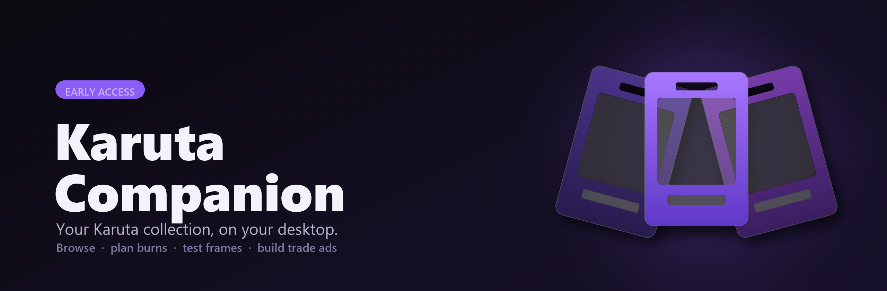

  

  
  
  
  

  <a href="https://github.com/slashneck/KarutaCompanion/releases/latest"><b>Download for Windows</b></a>
  &nbsp;&nbsp;|&nbsp;&nbsp;
  <a href="#features">Features</a>
  &nbsp;&nbsp;|&nbsp;&nbsp;
  <a href="#safety">Safety</a>
  &nbsp;&nbsp;|&nbsp;&nbsp;
  <a href="#updates">Updates</a>

---

Karuta Companion is a desktop app for your [Karuta](https://karuta.io/) card collection. Export your cards in Discord with `k!sheet`, import the file, and you can browse, sort and plan with your whole collection on screen. Cards are redrawn to look as close to the in-game version as I could get them.

> Early access: the app is still being worked on, so expect changes and some rough spots (dyes and morphs aren't drawn yet). It updates itself when new versions come out.

## Download

1. Get the latest `KarutaCompanionSetup-*.exe` from the [releases page](https://github.com/slashneck/KarutaCompanion/releases/latest).
2. Run it. It installs for your Windows user only, so there's no admin prompt.
3. Windows might show a SmartScreen warning since the app isn't signed yet. Click More info, then Run anyway.

Your collection and settings live in `%AppData%\com.karutacompanion.app`, separate from the app itself. Updating or uninstalling won't touch them.

## Features

- Collection view: import your `k!sheet` and see every card with its artwork, frame, quality and text.
- Artwork: card art and frames are downloaded from Karuta's image server when needed and cached on your PC.
- Frame tester (early access): try any Karuta frame on your own cards.
- Burn pile: tag the cards you want to burn and keep them in one list.
- Wishlist: paste your `k!wl` pages (or a screenshot of them) to see which ones you own, plus your most wished cards.
- Shop: list cards for trade, set prices, and copy a finished ad to post in Discord.
- Command list: buttons that copy the right `k!` command so you can paste it in Discord.

## Safety

This is a helper app, not a bot. You still do everything in Discord yourself.

- It doesn't connect to Discord, log in, or ask for your account or token.
- It doesn't play, drop, grab, trade or send messages for you.
- It doesn't automate anything or touch Karuta's economy. All it does is read the spreadsheet you give it and keep a list of commands for you to paste.

The card images in the app are recreations, not the actual images Karuta shows, so frames, dyes, wear and text can look a bit different. Use `k!view` in Discord to see the real card.

## Updates

The app checks this repo for new versions, downloads them in the background and installs them when you close it. You can also install right away, or turn auto updates off, in Settings > Updates. Each download is checked against its checksum before anything gets replaced.

---

Not affiliated with or endorsed by Karuta or Discord. Character art belongs to its owners and is only shown on your own PC. This repo only hosts the Windows download and updates; Karuta Companion itself is closed source.
